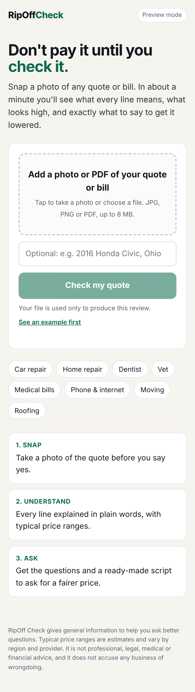

# RipOff Check

Take a photo of any quote or bill (car repair, home repair, dentist, vet, phone bill). Get back what each line means in plain words, what looks high against typical ranges, the questions to ask, and a script to ask for a fairer price.



## Status

- Working: the page, upload, and result screen.
- Not yet tested: the live AI review (needs an API key).
- Not built yet: customer accounts, the free-check limit per customer, and payments.

## Run it

```bash
npm install
```

```bash
ANTHROPIC_API_KEY=your-key npm start
```

Then open http://localhost:3000. Without a key it runs in preview mode and returns a made-up example.

## Settings (environment variables)

| Name | Default | What it does |
|---|---|---|
| `ANTHROPIC_API_KEY` | none | Turns on live reviews |
| `CHECK_MODEL` | `claude-opus-5-5` | Which Claude model reviews the document |
| `MAX_CHECKS_PER_IP_PER_DAY` | `5` | Daily limit per visitor |
| `MAX_CHECKS_PER_DAY` | `200` | Daily limit overall, to cap API spend |
| `PORT` | `3000` | Port the server listens on |

Never commit your API key. Keep it in the hosting provider's settings.
