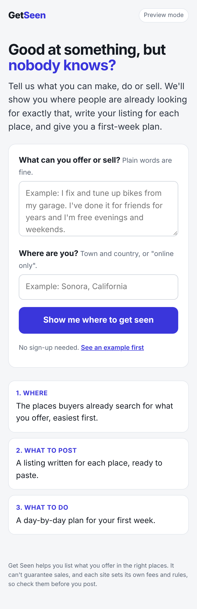

# Get Seen

For people who are good at something but have no audience. You describe what you can make, do or sell, and it returns:

1. The places where buyers already look for that specific thing, easiest first.
2. A listing written for each place, ready to paste.
3. A day-by-day plan for the first week.

The app is in [`get-seen/`](get-seen).



## Status

- Working: the page, the form, and the result screen.
- Not yet tested: the live AI plan (needs an API key).
- Not built yet: accounts and payments.

## Run it

```bash
cd get-seen && npm install
```

```bash
ANTHROPIC_API_KEY=your-key npm start
```

Then open http://localhost:3000. Without a key it runs in preview mode and returns a made-up example.

## Settings (environment variables)

| Name | Default | What it does |
|---|---|---|
| `ANTHROPIC_API_KEY` | none | Turns on live plans |
| `PLAN_MODEL` | `claude-opus-5-5` | Which Claude model writes the plan |
| `MAX_PLANS_PER_IP_PER_DAY` | `5` | Daily limit per visitor |
| `MAX_PLANS_PER_DAY` | `200` | Daily limit overall, to cap API spend |
| `PORT` | `3000` | Port the server listens on |

Never commit your API key. Keep it in the hosting provider's settings.

## Also in this repository

- [`ripoff-check/`](ripoff-check): an earlier prototype that reviews a photo of a quote or bill.
- [`samples/plumber/`](samples/plumber): a sample one-page business website.
